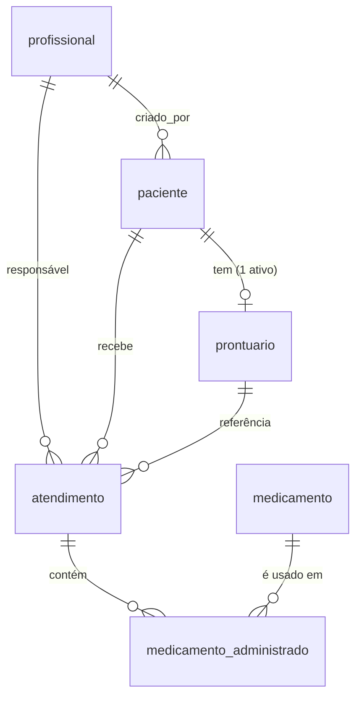

# Modelo de dados

## Banco central (PostgreSQL)

Scripts: [001_schema.sql](../banco/001_schema.sql) (estrutura), [002_permissoes.sql](../banco/002_permissoes.sql) (usuários e permissões) e [003_seed.sql](../banco/003_seed.sql) (dados fictícios). O script [criar_banco.sh](../banco/criar_banco.sh) executa os três em sequência.



### Colunas de controle

Presentes em `paciente`, `prontuario`, `medicamento`, `atendimento` e `profissional`:

| Coluna | Para que serve |
|---|---|
| `id UUID` | Identificador **gerado no cliente** (o app cria o UUID offline). É estável: o mesmo registro tem o mesmo id no dispositivo e no servidor. |
| `versao` | Começa em 1 e sobe a cada alteração. É usada para detectar conflitos. |
| `seq_alteracao` | Número da sequência global `seq_alteracao_global`. O pull devolve tudo com `seq_alteracao > cursor`. |
| `criado_em`, `atualizado_em` | Datas do servidor. |
| `alterado_no_cliente_em` | Quando o profissional fez a alteração no dispositivo. É usada pela estratégia "última escrita vence". |
| `excluido_em` | Exclusão lógica. O registro nunca é apagado, e o pull envia a exclusão para os dispositivos. |

O trigger `controlar_versao()` preenche `versao`, `seq_alteracao` e as datas em todo `INSERT` e `UPDATE`. Por isso um medicamento inserido à mão pelo `psql` (passo 9 do roteiro) também chega aos dispositivos no pull.

### Tabelas

**profissional**

Guarda nome, `tipo_registro` (CRM, COREN ou SOCORRISTA), `numero_registro`, `senha_hash` (bcrypt), `perfil` (admin, medico, enfermeiro, socorrista), e-mail e `ativo`. O par tipo + número é único. Um profissional é desativado (`ativo = false`), nunca excluído, porque continua sendo o responsável pelos atendimentos que registrou.

**paciente** (a "pessoa" das APIs)

Guarda nome, CPF (opcional, único entre os ativos), data de nascimento, sexo, telefone, e-mail e contato de emergência. A coluna `criado_por` aponta para o profissional que fez o cadastro.

**prontuario**

Guarda `paciente_id`, tipo sanguíneo, alergias, comorbidades, uso contínuo e observações. Existe um índice único parcial que garante **um prontuário ativo por paciente**.

**medicamento**

Catálogo com nome, princípio ativo, apresentação, concentração, via padrão e `alerta`.
- O `alerta` é um texto informativo mostrado ao socorrista, sem nenhuma regra clínica automática.
- O app também avisa quando o nome do medicamento aparece nas alergias do prontuário. É só um aviso: ele não bloqueia o registro.

**atendimento**

| Grupo | Campos |
|---|---|
| Identificação | `paciente_id`, `prontuario_id`, `profissional_id`, `data_hora`, `tipo_ocorrencia`, `local`, `descricao` |
| Sinais vitais | `pa_sistolica`, `pa_diastolica`, `fc`, `fr`, `spo2`, `temperatura`, `glicemia` |
| Escala de Glasgow | `glasgow_ocular` (1–4), `glasgow_verbal` (1–5), `glasgow_motora` (1–6) e `glasgow_total`, uma coluna calculada pelo banco (soma dos três) |
| Triagem | `manchester` (vermelho, laranja, amarelo, verde, azul) e `start` (vermelho, amarelo, verde, preto) |

Os `CHECK` dos sinais vitais apenas barram erros de digitação, como uma SpO2 de 150%. Eles não são regras clínicas.

**medicamento_administrado**

Guarda `atendimento_id`, `medicamento_id`, dose, unidade, via, horário e observação. É gravado sempre junto com o atendimento, na mesma transação, e por isso não tem versão própria.

**sync_operacao**

Rastro de cada operação recebida do app:
- `op_id` (chave primária, a base da idempotência);
- `dispositivo_id` e `profissional_id`;
- entidade, `entidade_id`, ação e `versao_base`;
- status (aplicada, conflito ou erro) e mensagem;
- `payload_cliente` e `payload_servidor` (`jsonb`), que guardam as duas versões em caso de conflito.

**log_acesso**

Guarda `data_hora`, serviço, `origem` (servidor ou cliente), IP, `profissional_id`, método, rota, status e `duracao_ms`. Não tem chave estrangeira para `profissional`, porque o log precisa existir mesmo para tentativas inválidas.

### Permissões

| Usuário do banco | Pode gravar | Pode ler |
|---|---|---|
| `mf_cadastros` | profissional, paciente, prontuario, medicamento (sem DELETE) | log_acesso |
| `mf_atendimentos` | atendimento (sem DELETE), medicamento_administrado | paciente, prontuario, medicamento, profissional (sem `senha_hash`) |
| `mf_sync` | sync_operacao | todas as clínicas, profissional (sem `senha_hash`) |

Todos podem inserir em `log_acesso`. Como nenhum usuário tem `DELETE` nas tabelas clínicas, a exclusão lógica é garantida pelo banco.

## Banco local (IndexedDB, no navegador)

Definido em [web/socorrista/db-local.js](../web/socorrista/db-local.js) (banco `medicalfield`, versão 1).

| Store | Chave | Conteúdo |
|---|---|---|
| `pacientes`, `prontuarios`, `atendimentos` | `id` (índice `paciente_id`) | Cópia local dos registros, no mesmo formato do servidor |
| `medicamentos`, `profissionais` | `id` | Recebidos pelo pull (somente leitura no app) |
| `outbox` | `seq` (autoincremento; índice `entidade_id`) | Fila de operações pendentes: `op_id`, entidade, ação, `versao_base`, dados, tentativas, último erro |
| `logs` | `seq` | Operações locais para enviar em `POST /api/log` |
| `historico_sync` | `seq` | Resultado de cada operação enviada (aplicada, duplicada, conflito ou erro) |
| `meta` | `chave` | `cursor` do pull, `dispositivo_id`, `sessao`, credenciais offline (hash PBKDF2) e data da última sincronização |

## Recriar o banco

```bash
banco/criar_banco.sh --recriar            # apaga e recria o banco medicalfield
banco/criar_banco.sh medicalfield_teste   # banco separado, usado pelos testes automáticos
```
